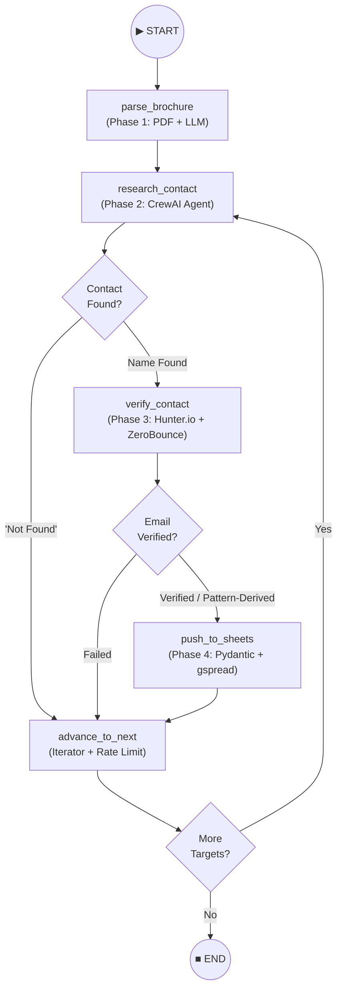

# CQ Tech Team AI Agent — Complete Documentation (LangGraph Edition)

---

## 1. Executive Summary

**Agent Name:** CQ Tech Team AI Agent  
**Orchestration Framework:** LangGraph `StateGraph` + CrewAI agents  
**Goal:** Autonomously process an event brochure, search the web for corporate decision-makers, verify their emails, and push clean structured leads to Google Sheets.

> [!IMPORTANT]
> The master pipeline (`main_pipeline.py`) now uses **LangGraph** as the state-machine orchestrator. Each phase is a graph node; conditional edges handle routing (skip not-found contacts, drop failed verifications, loop through all targets).

---

## 2. LangGraph Architecture

### State Graph Topology



### How It Works

| Component | Role |
|---|---|
| **`StateGraph(AgentState)`** | LangGraph typed state machine that carries data between nodes |
| **`AgentState` (TypedDict)** | Defines all fields flowing through the graph: domains, job titles, iteration indices, contact data, results list |
| **5 Nodes** | `parse_brochure`, `research_contact`, `verify_contact`, `push_to_sheets`, `advance_to_next` |
| **3 Conditional Edges** | `route_after_research`, `route_after_verification`, `route_after_advance` |
| **`graph.invoke(initial_state)`** | Kicks off the entire workflow — LangGraph handles node transitions automatically |

---

## 3. Project Directory Structure

```
ai_event_agent/
├── brochure.pdf               # Input event brochure (PDF)
├── credentials.json           # Google Cloud service account key
├── phase1_context.py          # Phase 1: PDF text extraction + LLM context generation
├── phase2_orchestration.py    # Phase 2: CrewAI web research agent + tools
├── phase3_verification.py     # Phase 3: Hunter.io discovery + ZeroBounce verification
├── phase4_output.py           # Phase 4: Pydantic schema validation + Google Sheets push
├── main_pipeline.py           # ★ LangGraph StateGraph orchestrator (connects all phases)
└── requirements.txt           # Python dependencies (includes langgraph)
```

---

## 4. Full Code

### 4.1 `requirements.txt`
```text
# Phase 1: Context Generation
pdfplumber
pydantic
openai

# Phase 2: Orchestration & Searching
crewai
crewai-tools
langchain-openai

# LangGraph State Machine Orchestrator
langgraph
langchain

# Phase 3: Extraction & Verification
requests

# Phase 4: Output Pipeline
gspread
```

---

### 4.2 Phase 1: Context Generation (`phase1_context.py`)
```python
import os
import pdfplumber
from pydantic import BaseModel
from openai import OpenAI

os.environ["OPENAI_API_KEY"] = "sk-YOUR-OPENAI-API-KEY-HERE" 
client = OpenAI()

class EventContext(BaseModel):
    target_industries: list[str]
    keywords: list[str]
    target_domains: list[str]
    job_titles: list[str]

def extract_text(pdf_path):
    print("Extracting text from PDF...")
    extracted_text = ""
    with pdfplumber.open(pdf_path) as pdf:
        for page in pdf.pages:
            text = page.extract_text()
            if text:
                extracted_text += text + "\n"
    return extracted_text

def generate_master_list(brochure_text):
    print("Sending data to OpenAI to generate the master list...")
    response = client.beta.chat.completions.parse(
        model="gpt-4o-mini", 
        messages=[
            {
                "role": "system", 
                "content": (
                    "You are an expert Event Strategist. Analyze the event brochure. "
                    "Identify target industries, keywords, target company domains, and the exact "
                    "job titles of decision-makers to contact (e.g., 'Marketing Lead', 'CSR Head')."
                )
            },
            {
                "role": "user", 
                "content": f"Here is the event brochure text:\n\n{brochure_text}"
            }
        ],
        response_format=EventContext,
    )
    return response.choices[0].message.parsed

if __name__ == "__main__":
    pdf_file_path = "brochure.pdf" 
    raw_text = extract_text(pdf_file_path)
    master_list = generate_master_list(raw_text)
    print("\n--- AI GENERATED MASTER LIST ---")
    print(f"Target Industries: {master_list.target_industries}")
    print(f"Keywords: {master_list.keywords}")
    print(f"Target Domains: {master_list.target_domains}")
    print(f"Target Job Titles: {master_list.job_titles}")
```

---

### 4.3 Phase 2: Orchestration & Searching (`phase2_orchestration.py`)
```python
import os
from crewai import Agent, Task, Crew
from crewai_tools import SerperDevTool, ScrapeWebsiteTool

os.environ["OPENAI_API_KEY"] = "sk-YOUR-OPENAI-API-KEY-HERE" 
os.environ["SERPER_API_KEY"] = "YOUR-SERPER-API-KEY-HERE" 

search_tool = SerperDevTool()
scrape_tool = ScrapeWebsiteTool()

research_agent = Agent(
    role="Corporate Web Research Specialist",
    goal="Find the exact names and current roles of decision-makers at target organizations.",
    backstory="You are an expert at navigating corporate websites, reading 'About Us' and "
              "'Team' pages, and finding key personnel.",
    tools=[search_tool, scrape_tool],
    verbose=True,
    memory=True,
    allow_delegation=False
)

def create_research_task(target_domain, job_title):
    return Task(
        description=(
            f"1. Search the web for the organization '{target_domain}'.\n"
            f"2. Find their official website and scrape their 'About Us' or 'Team' pages.\n"
            f"3. Identify the name of the person holding the title of '{job_title}' or a similar role.\n"
            f"4. If a link is dead or information is missing, run a new search to find alternative sources."
        ),
        expected_output=f"The full name and exact role of the {job_title} at {target_domain}. "
                        f"If no one is found, output 'Not Found'.",
        agent=research_agent
    )

if __name__ == "__main__":
    sample_domain = "Tech Mahindra"
    sample_job_title = "Marketing Lead"
    print(f"Starting Phase 2 autonomous search for {sample_job_title} at {sample_domain}...")
    research_task = create_research_task(sample_domain, sample_job_title)
    crew = Crew(agents=[research_agent], tasks=[research_task], verbose=True)
    result = crew.kickoff()
    print("\n--- AI AGENT SEARCH RESULT ---")
    print(result)
```

---

### 4.4 Phase 3: Extraction & Verification (`phase3_verification.py`)
```python
import os
import requests

os.environ["HUNTER_API_KEY"] = "YOUR-HUNTER-API-KEY-HERE"
os.environ["ZEROBOUNCE_API_KEY"] = "YOUR-ZEROBOUNCE-API-KEY-HERE"

def discover_email(first_name, last_name, domain):
    print(f"Asking Hunter.io to find email for {first_name} {last_name} at {domain}...")
    api_key = os.environ.get("HUNTER_API_KEY")
    url = (f"https://api.hunter.io/v2/email-finder?domain={domain}"
           f"&first_name={first_name}&last_name={last_name}&api_key={api_key}")
    response = requests.get(url)
    if response.status_code == 200:
        data = response.json()
        email = data.get("data", {}).get("email")
        return email
    return None

def verify_email(email):
    print(f"Pinging ZeroBounce to verify deliverability for {email}...")
    api_key = os.environ.get("ZEROBOUNCE_API_KEY")
    url = f"https://api.zerobounce.net/v2/validate?api_key={api_key}&email={email}"
    response = requests.get(url)
    if response.status_code == 200:
        data = response.json()
        status = data.get("status") 
        return status
    return "error"

def process_contact(full_name, domain):
    name_parts = full_name.split()
    first_name = name_parts[0]
    last_name = name_parts[-1] if len(name_parts) > 1 else ""
    email = discover_email(first_name, last_name, domain)
    if not email:
        print("Contact not found or link is dead. Looping back for alternative contact...")
        return {"status": "Failed", "reason": "No email found"}
    verification_status = verify_email(email)
    if verification_status == "valid":
        final_status = "Verified"
    else:
        final_status = "Pattern-Derived"
    return {
        "Name": full_name,
        "Email": email,
        "Verification Status": final_status
    }

if __name__ == "__main__":
    sample_name = "Jane Doe"
    sample_domain = "techmahindra.com"
    sample_role = "Marketing Lead"
    print(f"Starting Phase 3 Extraction & Verification for {sample_name} ({sample_role})...")
    result = process_contact(sample_name, sample_domain)
    print("\n--- VERIFICATION RESULT ---")
    print(result)
```

---

### 4.5 Phase 4: Output Pipeline (`phase4_output.py`)
```python
import gspread
from pydantic import BaseModel, ValidationError

def authenticate_google_sheets(credentials_file):
    print("Authenticating with Google Sheets API...")
    gc = gspread.service_account(filename=credentials_file)
    return gc

class VerifiedLead(BaseModel):
    organization_name: str
    category: str
    location: str
    contact_person: str
    contact_channel: str
    verification_status: str

def push_lead_to_sheet(gc, sheet_url, lead_data):
    try:
        print("Validating lead data format...")
        validated_lead = VerifiedLead(**lead_data)
        row_to_insert = [
            validated_lead.organization_name,
            validated_lead.category,
            validated_lead.location,
            validated_lead.contact_person,
            validated_lead.contact_channel,
            validated_lead.verification_status
        ]
        print("Connecting to Google Sheet and pushing data...")
        sheet = gc.open_by_url(sheet_url).sheet1
        sheet.append_row(row_to_insert)
        print("Success! Verified row directly pushed to the Google Sheet.")
        return True
    except ValidationError as e:
        print(f"Data formatting failed. The lead did not match the mandatory schema: {e}")
        return False

if __name__ == "__main__":
    SERVICE_ACCOUNT_FILE = "credentials.json"
    GOOGLE_SHEET_URL = "https://docs.google.com/spreadsheets/d/YOUR-SHEET-ID-HERE/edit"
    sample_lead = {
        "organization_name": "Tech Mahindra",
        "category": "Corporate IT",
        "location": "India",
        "contact_person": "Jane Doe - Marketing Lead",
        "contact_channel": "jane.doe@techmahindra.com",
        "verification_status": "Verified"
    }
    print("Starting Phase 4 Output Pipeline...")
    google_client = authenticate_google_sheets(SERVICE_ACCOUNT_FILE)
    push_lead_to_sheet(google_client, GOOGLE_SHEET_URL, sample_lead)
```

---

### 4.6 ★ Master Pipeline — LangGraph Orchestrator (`main_pipeline.py`)
```python
"""
CQ Tech Team AI Agent — Master Pipeline (LangGraph Orchestrator)

Graph topology:
    parse_brochure → research_contact ─┬─(Found)──► verify_contact ─┬─(Passed)──► push_to_sheets ──► advance_to_next
                                       │                            │                                       │
                                       └─(Not Found)──► advance_to_next ◄──(Failed)────────────────────────┘
                                                              │
                                                         (more?) ──► research_contact  OR  END
"""

import time
from typing import TypedDict, Literal
from langgraph.graph import StateGraph, END

from phase1_context import extract_text, generate_master_list
from phase2_orchestration import research_agent, create_research_task, Crew
from phase3_verification import process_contact
from phase4_output import authenticate_google_sheets, push_lead_to_sheet

PDF_FILE = "brochure.pdf"
CREDENTIALS_FILE = "credentials.json"
GOOGLE_SHEET_URL = "https://docs.google.com/spreadsheets/d/YOUR-SHEET-ID-HERE/edit"


# ─── LangGraph State Schema ──────────────────────────────────────────────────
class AgentState(TypedDict):
    brochure_text: str
    target_domains: list[str]
    job_titles: list[str]
    target_industries: list[str]
    current_domain_index: int
    current_title_index: int
    current_domain: str
    current_job_title: str
    decision_maker_name: str
    contact_data: dict
    results: list[dict]
    google_client: object


# ─── Graph Nodes ─────────────────────────────────────────────────────────────

def parse_brochure(state):
    raw_text = extract_text(PDF_FILE)
    master_list = generate_master_list(raw_text)
    google_client = authenticate_google_sheets(CREDENTIALS_FILE)
    return {
        "brochure_text": raw_text,
        "target_domains": master_list.target_domains,
        "job_titles": master_list.job_titles,
        "target_industries": master_list.target_industries,
        "current_domain_index": 0, "current_title_index": 0,
        "current_domain": master_list.target_domains[0] if master_list.target_domains else "",
        "current_job_title": master_list.job_titles[0] if master_list.job_titles else "",
        "google_client": google_client, "results": [],
    }

def research_contact(state):
    task = create_research_task(state["current_domain"], state["current_job_title"])
    crew = Crew(agents=[research_agent], tasks=[task], verbose=False)
    return {"decision_maker_name": str(crew.kickoff())}

def verify_contact(state):
    return {"contact_data": process_contact(state["decision_maker_name"], state["current_domain"])}

def push_to_sheets(state):
    contact = state["contact_data"]
    final_lead = {
        "organization_name": state["current_domain"],
        "category": state["target_industries"][0] if state["target_industries"] else "General",
        "location": "Global",
        "contact_person": contact.get("Name", state["decision_maker_name"]),
        "contact_channel": contact.get("Email", ""),
        "verification_status": contact.get("Verification Status", "Pattern-Derived"),
    }
    push_lead_to_sheet(state["google_client"], GOOGLE_SHEET_URL, final_lead)
    return {"results": state["results"] + [final_lead]}

def advance_to_next(state):
    d, t = state["current_domain_index"], state["current_title_index"]
    t += 1
    if t >= len(state["job_titles"]): t, d = 0, d + 1
    time.sleep(3)
    if d < len(state["target_domains"]):
        return {"current_domain_index": d, "current_title_index": t,
                "current_domain": state["target_domains"][d],
                "current_job_title": state["job_titles"][t]}
    return {"current_domain_index": d, "current_title_index": t}


# ─── Conditional Edges ───────────────────────────────────────────────────────

def route_after_research(state) -> Literal["verify_contact", "advance_to_next"]:
    return "advance_to_next" if "Not Found" in state["decision_maker_name"] else "verify_contact"

def route_after_verification(state) -> Literal["push_to_sheets", "advance_to_next"]:
    status = state["contact_data"].get("Verification Status", state["contact_data"].get("status"))
    return "advance_to_next" if status == "Failed" else "push_to_sheets"

def route_after_advance(state) -> Literal["research_contact", "__end__"]:
    return "research_contact" if state["current_domain_index"] < len(state["target_domains"]) else "__end__"


# ─── Build Graph ─────────────────────────────────────────────────────────────

def build_graph():
    wf = StateGraph(AgentState)
    wf.add_node("parse_brochure", parse_brochure)
    wf.add_node("research_contact", research_contact)
    wf.add_node("verify_contact", verify_contact)
    wf.add_node("push_to_sheets", push_to_sheets)
    wf.add_node("advance_to_next", advance_to_next)
    wf.set_entry_point("parse_brochure")
    wf.add_edge("parse_brochure", "research_contact")
    wf.add_edge("push_to_sheets", "advance_to_next")
    wf.add_conditional_edges("research_contact", route_after_research,
        {"verify_contact": "verify_contact", "advance_to_next": "advance_to_next"})
    wf.add_conditional_edges("verify_contact", route_after_verification,
        {"push_to_sheets": "push_to_sheets", "advance_to_next": "advance_to_next"})
    wf.add_conditional_edges("advance_to_next", route_after_advance,
        {"research_contact": "research_contact", "__end__": END})
    return wf.compile()

if __name__ == "__main__":
    print("CQ Tech Team AI Agent — LangGraph Orchestrator")
    graph = build_graph()
    final_state = graph.invoke({
        "brochure_text": "", "target_domains": [], "job_titles": [],
        "target_industries": [], "current_domain_index": 0,
        "current_title_index": 0, "current_domain": "", "current_job_title": "",
        "decision_maker_name": "", "contact_data": {}, "results": [], "google_client": None,
    })
    print(f"\nDone! {len(final_state['results'])} verified leads pushed.")
```

---

## 5. LangGraph Key Concepts Used

| LangGraph Concept | Where It's Used | Purpose |
|---|---|---|
| `StateGraph(AgentState)` | `build_graph()` | Creates a typed state machine where `AgentState` flows between nodes |
| `TypedDict` state | `AgentState` class | Ensures type safety for all 12 state fields across the graph |
| `add_node()` | 5 calls in `build_graph()` | Registers each phase function as a graph node |
| `set_entry_point()` | `"parse_brochure"` | Designates the first node to execute |
| `add_edge()` | Fixed transitions | `parse_brochure → research_contact` and `push_to_sheets → advance_to_next` |
| `add_conditional_edges()` | 3 routing functions | Dynamic branching based on runtime state (Not Found / Failed / more targets) |
| `END` sentinel | Terminal condition | Stops the graph when all domain × job_title combos are processed |
| `graph.invoke()` | `__main__` block | Executes the compiled graph end-to-end and returns the final state |

---

## 6. Step-by-Step Testing Guide

### Step 1: Environment Setup
```bash
cd /home/kinshuk/.gemini/antigravity/scratch/ai_event_agent
source venv/bin/activate
```

### Step 2: Configure API Keys
Update placeholder keys in:
- `phase1_context.py` (line 6) — `OPENAI_API_KEY`
- `phase2_orchestration.py` (lines 5–6) — `OPENAI_API_KEY`, `SERPER_API_KEY`
- `phase3_verification.py` (lines 4–5) — `HUNTER_API_KEY`, `ZEROBOUNCE_API_KEY`
- `main_pipeline.py` (line 36) — `GOOGLE_SHEET_URL`
- `phase4_output.py` (line 43) — `GOOGLE_SHEET_URL`

Set up `credentials.json` for Google Sheets (service account).

### Step 3: Test Individual Phases
```bash
python phase1_context.py          # Test PDF parsing + LLM
python phase2_orchestration.py    # Test CrewAI web research
python phase3_verification.py    # Test email verification
python phase4_output.py          # Test Google Sheets push
```

### Step 4: Run the Full LangGraph Pipeline
```bash
python main_pipeline.py
```

---

## 7. Troubleshooting

| Error | Cause | Fix |
|---|---|---|
| `AuthenticationError: Incorrect API key` | Placeholder key not replaced | Update the key strings in the relevant files |
| `SpreadsheetNotFound` / `403` | Sheet not shared with service account | Share with `client_email` from `credentials.json` |
| `FileNotFoundError: brochure.pdf` | Missing input | Place your PDF in the project directory |
| `RateLimitError: 429` | Too many API calls | Increase `time.sleep(3)` in `advance_to_next` |
| `ModuleNotFoundError: langgraph` | Package not installed | Run `pip install langgraph langchain` |
